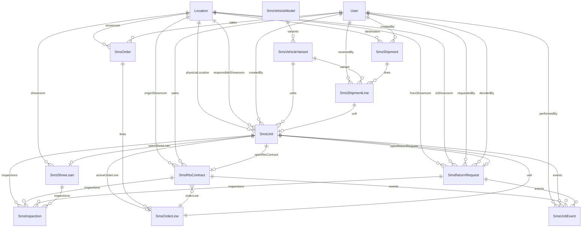

# Wedisense SMS — Rancangan Teknis

**Versi 2.1 · 2026-11-19** · Acuan produk: [stock-management-system.md](stock-management-system.md)

Disusun dari tiga rancangan independen, diuji empat reviewer terhadap skenario A01–A15, lalu direvisi. Prosa berbahasa Indonesia; identifier, nama tabel/kolom, dan kode berbahasa Inggris.

**Keputusan owner (2026-11-19):**
- Teks layar SMS berbahasa **Inggris, ditulis langsung seperti AMS** (tanpa wiring i18n, tanpa file locale `sms.json`).
- Nomor SPK dan nomor kontrak RTO **diketik admin** dari dokumen aslinya.
- **Tidak ada peran supervisor** untuk saat ini: admin showroom memegang seluruh kewenangan supervisor (satu admin per showroom). Izin tetap dipecah per kemampuan, sehingga peran supervisor bisa ditambahkan nanti tanpa mengubah kode (lihat §6).
- Review **per stage**, bukan per sub-tier; prioritas kecepatan delivery.
- Alur branch: feature → `staging` (https://staging-wedisense.wedison.tech) → `main`. Lihat [ci-cd.md](../ci-cd.md).

---

## 1. Ringkasan Keputusan

| Keputusan | Pilihan | Alasan singkat |
|---|---|---|
| Penamaan entitas | Prefix `Sms` di model Prisma; prefix `sms_` di tabel; prefix `Sms` di enum | konsistensi modul, tidak ada tumbukan dengan AMS |
| Produk | Wedison EV sendiri (contoh: model "Athena", varian "Extended") | Wedison bukan distributor Honda |
| Pemisahan Order/RTO | `SmsOrder`+`SmsOrderLine` untuk booking/jual, `SmsRtoContract` untuk setiap periode RTO | dua konsep berbeda dengan lifecycle berbeda |
| Invariant satu aktif per VIN | `SmsUnit.activeOrderLineId`, `openRtoContractId`, `openReturnRequestId` nullable @unique FK | Prisma null-unique enforces "paling banyak satu" tanpa raw SQL |
| Predicate fisik | `physicalLocationId = L` tanpa IN-list status | invariant di kolom physicalLocationId sendiri; null saat unit di luar |
| Pure reducer | `unit-state.ts`: `applyEvent(state, event) → newState \| InvalidTransition` | DB-free unit tests, replay verification, audit trail gratis |
| Koreksi | `supersedesEventId`/`voidsEventId` pada `SmsUnitEvent`; replay ledger; tidak ada tabel corrections | append-only terjaga; koreksi mid-chain dibatasi dampaknya |
| Return request | Kolom independen: `custodyReceivedAt`, `decidedAt`, `decision`; display status derived | dua kejadian fisik terpisah; status linear tidak bisa merepresentasikan keduanya |
| Otorisasi SMS | `locationPermissions: Map<locationId, Set<permission>>` di `resolveAuthenticatedUser`; `assertCan(user, perm, locationId)` di service | flat union tidak bisa menjawab "apakah user punya P di L khusus" |
| Idempotency | Tabel `SmsIdempotencyKey` unik per (key, userId, operation); ditulis di transaksi yang sama | cegah double-submit dan kirim-ulang setelah disconnect |
| Import shipment | Dedup 3 kelompok: batch ini, batch lain (PENDING), unit sudah ada di `sms_units` | konflik harus tampil di preview, bukan saat penerimaan |
| Frontend | Vertical slice per sub-tier; `NavItem` sebagai discriminated union; teks Inggris ditulis langsung seperti AMS; tour deferred | Setiap sub-tier bisa dicoba lewat UI di staging; mengikuti keputusan owner soal bahasa |
| Redis auth cache | Di luar scope v1; dicatat di risiko | Belum ada bukti perlu; ditinjau setelah pilot |

---

## 2. ERD

### Diagram Hubungan Entitas



### Spesifikasi Tabel

#### `sms_vehicle_models`
| Kolom | Tipe | Catatan |
|---|---|---|
| id | String UUID PK | |
| code | String | Unique; contoh: "ATHENA" |
| name | String | Contoh: "Athena" |
| isActive | Boolean | Default true |
| createdAt / updatedAt | DateTime | |

`@@index([isActive])`

#### `sms_vehicle_variants`
| Kolom | Tipe | Catatan |
|---|---|---|
| id | String UUID PK | |
| modelId | UUID FK→SmsVehicleModel | onDelete: Restrict |
| variantName | String | Contoh: "Extended" |
| batteryVariant | String? | Deskripsi baterai khusus EV |
| color | String | Nama warna terstandar |
| colorCode | String? | Hex opsional |
| isActive | Boolean | Default true |

`@@unique([modelId, variantName, color])`. `@@index([modelId])`.

#### `sms_shipments`
| Kolom | Tipe | Catatan |
|---|---|---|
| id | String UUID PK | |
| shipmentNumber | String | Unique; `SMS_SHIPMENT` sequence, contoh: MFT-202411-0001 |
| factoryReference | String? | Nomor surat jalan; mengikat sibling batches ke showroom lain |
| destinationLocationId | UUID FK→Location | onDelete: Restrict |
| originLocationId | UUID FK→Location? | Pabrik Cikarang |
| dispatchDate / expectedArrivalDate | Date? | |
| status | SmsShipmentStatus | Default DRAFT |
| columnMappingSnapshot | Json? | Pemetaan kolom terakhir dipakai |
| createdByUserId | UUID FK→User | |
| createdAt / updatedAt | DateTime | |

`SmsShipmentStatus`: `DRAFT | OPEN | PARTIALLY_RECEIVED | FULLY_RECEIVED | CLOSED`
`@@index([destinationLocationId, status])`

#### `sms_shipment_lines`
| Kolom | Tipe | Catatan |
|---|---|---|
| id | String UUID PK | |
| shipmentId | UUID FK→SmsShipment | onDelete: Restrict |
| vin | String | Preserved as-is; VARCHAR(25) |
| engineNumber | String? | |
| variantId | UUID FK→SmsVehicleVariant? | Diisi saat import |
| sourceRowNumber | Int | Baris di Excel sumber |
| sourceRowSnapshot | Json | Raw row untuk review |
| receiptStatus | SmsShipmentLineStatus | Default PENDING |
| discrepancyNotes | String? | |
| unitId | UUID FK→SmsUnit? @unique | Diisi saat unit diterima fisik |
| receivedByUserId / receivedAt | nullable | |
| createdAt / updatedAt | DateTime | |

`SmsShipmentLineStatus`: `PENDING | RECEIVED_OK | RECEIVED_DAMAGED | DISCREPANCY | SUPERSEDED`
`@@unique([shipmentId, vin])`. `@@index([shipmentId, receiptStatus])`. `@@index([vin])`.

#### `sms_units`
| Kolom | Tipe | Catatan |
|---|---|---|
| id | String UUID PK | |
| vin | String @unique | |
| engineNumber | String? @unique | |
| licensePlate | String? | Dapat dilengkapi kemudian |
| variantId | UUID FK→SmsVehicleVariant | onDelete: Restrict |
| physicalLocationId | UUID FK→Location? | null = di customer / di luar / belum tiba |
| responsibleShowroomId | UUID FK→Location | Showroom penanggung jawab |
| status | SmsUnitStatus | Default MANIFEST_PENDING |
| wasRto | Boolean | Default false; satu arah, tidak pernah direset |
| isOpeningBalance | Boolean | Default false |
| shipmentId | UUID FK→SmsShipment? | onDelete: SetNull |
| activeOrderLineId | UUID FK→SmsOrderLine? @unique | Booking/sale yang mengunci VIN ini |
| openRtoContractId | UUID FK→SmsRtoContract? @unique | Kontrak RTO yang sedang terbuka |
| openReturnRequestId | UUID FK→SmsReturnRequest? @unique | Permintaan retur yang belum selesai |
| openShowLoanId | UUID FK→SmsShowLoan? @unique | Show loan aktif |
| createdByUserId | UUID FK→User | |
| createdAt / updatedAt | DateTime | |

`SmsUnitStatus`: `MANIFEST_PENDING | AVAILABLE | BOOKED | SOLD_PENDING_PICKUP | PICKED_UP | ACTIVE_RTO | CUSTODY | INSPECTION | SHOW_UNIT | IDENTITY_MISMATCH`

`@@index([status])`. `@@index([physicalLocationId, status])`. `@@index([responsibleShowroomId, status])`. `@@index([variantId])`.

**Tidak ada soft delete** — VIN tidak pernah dihapus.

Keempat pointer adalah relasi Prisma bernama (named relation) dengan FK nullable + `@unique` di sisi `SmsUnit`. Relasinya melingkar (SmsUnit ↔ SmsOrderLine/SmsRtoContract/SmsReturnRequest/SmsShowLoan), tetapi TIDAK membutuhkan constraint DEFERRABLE: baris anak selalu di-INSERT lebih dulu (FK-nya ke unit sudah valid), baru pointer di `sms_units` di-UPDATE dalam transaksi yang sama. Prisma membuat tabel dulu lalu `ALTER TABLE ... ADD CONSTRAINT` untuk FK, sehingga urutan DDL aman. Kolom nullable `@unique`: nilai non-null wajib unik; NULL boleh berulang (perilaku standar PostgreSQL).

#### `sms_unit_events`
Append-only. **Dijaga trigger `BEFORE UPDATE OR DELETE` (approval gate, lihat §10).**

| Kolom | Tipe | Catatan |
|---|---|---|
| id | String UUID PK | |
| unitId | UUID FK→SmsUnit | onDelete: Restrict |
| eventType | SmsUnitEventType | |
| eventDate | Date | Tanggal operasional; boleh mundur |
| recordedAt | DateTime | Waktu input; `@default(now())` |
| performedByUserId | UUID FK→User? | null untuk sistem/opening balance |
| **Snapshot hasil reducer:** | | |
| statusAfter | SmsUnitStatus | |
| physicalLocationAfter | UUID FK→Location? | |
| responsibleShowroomAfter | UUID FK→Location | |
| **Referensi konteks:** | | |
| orderId | UUID FK→SmsOrder? | |
| orderLineId | UUID FK→SmsOrderLine? | |
| rtoContractId | UUID FK→SmsRtoContract? | |
| returnRequestId | UUID FK→SmsReturnRequest? | |
| showLoanId | UUID FK→SmsShowLoan? | |
| inspectionId | UUID FK→SmsInspection? | |
| **Koreksi:** | | |
| supersedesEventId | UUID FK→SmsUnitEvent? @unique | Menggantikan data bisnis event ini |
| voidsEventId | UUID FK→SmsUnitEvent? @unique | Membatalkan event ini (hanya event terbaru) |
| notes / attachments (Json?) | nullable | |
| createdAt | DateTime | `@default(now())` — NO updatedAt |

`SmsUnitEventType`: `SHIPMENT_IMPORTED | OPENING_BALANCE | RECEIPT_OK | RECEIPT_DAMAGED | IDENTITY_MISMATCH_FOUND | IDENTITY_RESOLVED | BOOKING_CREATED | BOOKING_CANCELLED | SALE_RECORDED | PICKUP_CONFIRMED | SALE_RETURN_RECEIVED | RTO_STARTED | RTO_RETURNED | RTO_REPOSSESSED | RTO_OWNERSHIP_TRANSFERRED | CONTRACT_CLOSED | UNIT_RELEASED | RETURN_REQUESTED | CUSTODY_RECEIVED | RETURN_APPROVED | RETURN_REJECTED | OFFICIAL_RECEIPT_CONFIRMED | SHOW_UNIT_DISPATCHED | SHOW_UNIT_RETURNED | INSPECTION_STARTED | INSPECTION_PASSED | UNIT_EVENT_VOIDED`

**Ledger efektif** = events di mana `id NOT IN (SELECT supersedesEventId ...) AND id NOT IN (SELECT voidsEventId ...)`.

`@@index([unitId, createdAt])`. `@@index([rtoContractId])`. `@@index([returnRequestId])`.

#### `sms_orders`
| Kolom | Tipe | Catatan |
|---|---|---|
| id | String UUID PK | |
| showroomId | UUID FK→Location | |
| spkNumber | String | DIKETIK admin dari kertas SPK |
| salesUserId | UUID FK→User? | Pegawai; login opsional |
| customerName | String | Snapshot customer |
| customerPhone | String? | |
| customerIdNumber | String? | KTP; hanya tampil dengan sms-customers:view |
| notes | String? | |
| createdByUserId | UUID FK→User | |
| createdAt / updatedAt | DateTime | |

`@@unique([showroomId, spkNumber])`. `@@index([showroomId])`.

#### `sms_order_lines`
| Kolom | Tipe | Catatan |
|---|---|---|
| id | String UUID PK | |
| orderId | UUID FK→SmsOrder | onDelete: Restrict |
| unitId | UUID FK→SmsUnit | onDelete: Restrict |
| status | SmsOrderLineStatus | Default BOOKED |
| bookedAt | DateTime | |
| followUpAt | DateTime? | Pengingat tindak lanjut |
| soldAt | DateTime? | |
| pickedUpAt / pickedUpByUserId | nullable | |
| receiverName / handoverReference | String? | Saat konfirmasi pengambilan |
| cancelledAt / cancelReason | nullable | |
| rtoHandoverAt | DateTime? | Jika berakhir dengan RTO_HANDED_OVER |
| returnedAt / returnReason | nullable | Jika berakhir dengan RETURNED |
| createdAt / updatedAt | DateTime | |

`SmsOrderLineStatus`: `BOOKED | SOLD | PICKED_UP | RTO_HANDED_OVER | CANCELLED | RETURNED`

`@@index([orderId])`. `@@index([unitId])`.

#### `sms_rto_contracts`
| Kolom | Tipe | Catatan |
|---|---|---|
| id | String UUID PK | |
| contractNumber | String @unique | DIKETIK admin; nomor dari dokumen RTO |
| unitId | UUID FK→SmsUnit | onDelete: Restrict |
| originShowroomId | UUID FK→Location | Immutable; showroom asal kontrak |
| orderLineId | UUID FK→SmsOrderLine? | null untuk opening balance atau direct handover |
| salesUserId | UUID FK→User? | |
| customerName / customerPhone / customerIdNumber | String? | Snapshot |
| startDate | Date | |
| handoverAt | DateTime? | Waktu unit benar-benar keluar |
| returnKind | SmsReturnKind? | RETURNED_BY_CUSTOMER \| REPOSSESSED |
| returnedAt | DateTime? | |
| receivedAtShowroomId | UUID FK→Location? | |
| closedAt / closedByUserId | nullable | Admin SMS mencatat setelah legal konfirmasi |
| legalReference | String? | |
| outcome | SmsRtoOutcome? | RETURNED \| REPOSSESSED \| OWNERSHIP_TRANSFERRED |
| isOpeningBalance | Boolean | Default false |
| createdByUserId / createdAt / updatedAt | | |

`SmsRtoOutcome`: `RETURNED | REPOSSESSED | OWNERSHIP_TRANSFERRED`
Kontrak TERBUKA selama `closedAt IS NULL`.

`@@index([unitId, closedAt])`. `@@index([originShowroomId])`.

#### `sms_return_requests`
| Kolom | Tipe | Catatan |
|---|---|---|
| id | String UUID PK | |
| requestNumber | String @unique | `SMS_RETURN` sequence; RTR-YYYYMM-NNNN |
| unitId | UUID FK→SmsUnit | onDelete: Restrict |
| fromShowroomId | UUID FK→Location | Showroom PJ saat pengajuan; immutable |
| toShowroomId | UUID FK→Location | Showroom penerima; immutable |
| requestedAt / requestedByUserId | | |
| reason | String | |
| **Keputusan (independen dari fisik):** | | |
| decision | SmsReturnDecision | Default PENDING |
| decidedAt / decidedByUserId / decisionReason | nullable | |
| **Fisik (independen dari keputusan):** | | |
| custodyReceivedAt / custodyReceivedByUserId | nullable | Motor tiba di toShowroom |
| officialReceivedAt / officialReceivedByUserId | nullable | Konfirmasi resmi; idempotent |
| **Resolusi jika ditolak dan fisik sudah ada:** | | |
| custodyResolvedAt / custodyResolvedByUserId / custodyResolvedHow | nullable | |
| createdAt / updatedAt | DateTime | |

`SmsReturnDecision`: `PENDING | APPROVED | REJECTED`

**Display status derived** (tidak disimpan):
- `PENDING, no custody` → "Menunggu keputusan"
- `PENDING, custody exists` → "Dititipkan, menunggu keputusan"
- `APPROVED, no custody` → "Disetujui, menunggu motor tiba"
- `APPROVED, custody, no official` → "Siap konfirmasi resmi"
- `officialReceivedAt IS NOT NULL` → "Diterima resmi"
- `REJECTED, no custody` → "Ditolak"
- `REJECTED, custody, no resolved` → "Tertahan di [toShowroom]"
- `REJECTED, resolved` → "Selesai (ditolak)"

**Guard konfirmasi resmi:** `custodyReceivedAt IS NOT NULL AND decidedAt IS NOT NULL AND decision = APPROVED AND officialReceivedAt IS NULL`. Re-konfirmasi sudah resmi = idempotent no-op.

`@@index([unitId])`. `@@index([fromShowroomId, decision])`. `@@index([toShowroomId, decision])`.

#### `sms_inspections`
| Kolom | Tipe | Catatan |
|---|---|---|
| id | String UUID PK | |
| unitId / rtoContractId? / returnRequestId? / showLoanId? | UUID FK nullable | Konteks inspeksi |
| inspectorUserId / inspectedAt | nullable | |
| odometer | Int? | |
| condition | SmsVehicleCondition? | NEW \| GOOD \| FAIR \| POOR \| DAMAGED |
| findings / photos (Json?) / notes | nullable | |
| result | SmsInspectionResult | Default PENDING |
| createdAt / updatedAt | DateTime | |

`SmsInspectionResult`: `PENDING | PASSED | FAILED`

#### `sms_show_loans`
| Kolom | Tipe | Catatan |
|---|---|---|
| id | String UUID PK | |
| unitId | UUID FK→SmsUnit | onDelete: Restrict |
| showroomId | UUID FK→Location | Showroom yang mengirim |
| eventName | String | |
| eventLocation | String | Teks bebas; venue bukan FK ke locations |
| picUserId | UUID FK→User? | onDelete: SetNull |
| dispatchedAt | DateTime | |
| expectedReturnDate | Date | Wajib; untuk overdue alert |
| returnedAt / returnedByUserId | nullable | |
| returnCondition | SmsVehicleCondition? | |
| hasFindings | Boolean | Default false |
| createdAt / updatedAt | DateTime | |

`@@index([unitId])`. `@@index([returnedAt, expectedReturnDate])` (untuk overdue query).

#### `sms_idempotency_keys`
| Kolom | Tipe | Catatan |
|---|---|---|
| id | String UUID PK | |
| key | String @unique | UUID dibuat di client saat form dibuka |
| userId | UUID FK→User | |
| operation | String | Contoh: "booking", "pickup", "official-receipt" |
| requestHash | String | Hash body request |
| resultReference | String? | ID resource yang dibuat |
| createdAt | DateTime | |

**Reference numbers** via tabel existing `document_number_sequences`:
`SMS_SHIPMENT`, `SMS_RETURN` (untuk SmsReturnRequest). SmsOrder.spkNumber dan SmsRtoContract.contractNumber diketik admin — tidak di-generate.

---

## 3. Model Keadaan Unit

### Dimensi

| Dimensi | Kolom | Deskripsi |
|---|---|---|
| Status | `sms_units.status` | Enum SmsUnitStatus; proyeksi dari reducer |
| Lokasi fisik | `sms_units.physicalLocationId` | non-null ↔ motor ada di dalam showroom |
| Showroom PJ | `sms_units.responsibleShowroomId` | Berubah hanya saat `officialReceivedAt` pada return request |
| Riwayat RTO | `sms_units.wasRto` | Satu arah; tidak pernah false kembali |

### Pure Reducer

```typescript
// apps/api/src/modules/sms/unit-state.ts
export interface SmsUnitState {
  status: SmsUnitStatus;
  physicalLocationId: string | null;
  responsibleShowroomId: string;
}
export type ReducerResult =
  | { ok: true; newState: SmsUnitState }
  | { ok: false; error: 'INVALID_TRANSITION'; reason: string };

export function applyEvent(state: SmsUnitState, event: { eventType: SmsUnitEventType; [k: string]: unknown }): ReducerResult;
```

Setiap `SmsUnitEvent` menyimpan `statusAfter`, `physicalLocationAfter`, `responsibleShowroomAfter` — snapshot dari `newState`. Ini memungkinkan: (1) unit test tanpa DB, (2) script verifikasi yang replay ledger dan bandingkan dengan baris `sms_units`, (3) test predicate fisik/siap sebagai fungsi murni.

### Diagram Status

```mermaid
stateDiagram-v2
    [*] --> MANIFEST_PENDING : SHIPMENT_IMPORTED
    MANIFEST_PENDING --> AVAILABLE : RECEIPT_OK
    MANIFEST_PENDING --> INSPECTION : RECEIPT_DAMAGED
    MANIFEST_PENDING --> IDENTITY_MISMATCH : IDENTITY_MISMATCH_FOUND

    IDENTITY_MISMATCH --> AVAILABLE : IDENTITY_RESOLVED (layak)
    IDENTITY_MISMATCH --> INSPECTION : IDENTITY_RESOLVED (rusak)

    AVAILABLE --> BOOKED : BOOKING_CREATED
    AVAILABLE --> ACTIVE_RTO : RTO_STARTED
    AVAILABLE --> SHOW_UNIT : SHOW_UNIT_DISPATCHED

    BOOKED --> AVAILABLE : BOOKING_CANCELLED
    BOOKED --> SOLD_PENDING_PICKUP : SALE_RECORDED
    BOOKED --> ACTIVE_RTO : RTO_STARTED (dari booking, line→RTO_HANDED_OVER)

    SOLD_PENDING_PICKUP --> PICKED_UP : PICKUP_CONFIRMED
    SOLD_PENDING_PICKUP --> INSPECTION : SALE_RETURN_RECEIVED

    PICKED_UP --> INSPECTION : SALE_RETURN_RECEIVED

    ACTIVE_RTO --> CUSTODY : CUSTODY_RECEIVED
    ACTIVE_RTO --> INSPECTION : RTO_RETURNED / RTO_REPOSSESSED
    ACTIVE_RTO --> PICKED_UP : RTO_OWNERSHIP_TRANSFERRED

    CUSTODY --> INSPECTION : OFFICIAL_RECEIPT_CONFIRMED
    CUSTODY --> CUSTODY : RETURN_REJECTED (fisik tetap; antrean tindak lanjut)
    CUSTODY --> ACTIVE_RTO : CUSTODY_HANDED_BACK (titipan ditolak, motor diserahkan kembali ke rider)
    ACTIVE_RTO --> INSPECTION : OFFICIAL_RECEIPT_CONFIRMED (disetujui, tanpa titipan sebelumnya)

    INSPECTION --> AVAILABLE : UNIT_RELEASED (semua tiga kondisi terpenuhi)

    SHOW_UNIT --> AVAILABLE : SHOW_UNIT_RETURNED (layak)
    SHOW_UNIT --> INSPECTION : SHOW_UNIT_RETURNED (dengan temuan)
```



### Tabel Transisi

| Operasi | Guard di service | Efek pada `sms_units` | Izin & assertCan lokasi |
|---|---|---|---|
| Terima shipment (OK) | `receiptStatus=PENDING`; shipment.destinationLocationId | status=AVAILABLE, physicalLocationId=destination, responsibleShowroomId=destination | `sms-receiving:manage` di destination |
| Terima shipment (rusak) | sama | status=INSPECTION, physicalLocationId=destination | `sms-receiving:manage` di destination |
| Temuan identitas | Motor ada fisik, tidak ada di manifest | status=IDENTITY_MISMATCH, physicalLocationId=showroom | `sms-receiving:manage` di showroom |
| Booking | status=AVAILABLE; FOR UPDATE; `activeOrderLineId IS NULL` | status=BOOKED; set activeOrderLineId | `sms-orders:manage` di unit.physicalLocationId |
| Batalkan booking | status=BOOKED | status=AVAILABLE; clear activeOrderLineId | `sms-orders:manage` di unit.physicalLocationId |
| Catat jual putus | status=BOOKED | status=SOLD_PENDING_PICKUP | `sms-orders:manage` di unit.physicalLocationId |
| Konfirmasi diambil | status=SOLD_PENDING_PICKUP | status=PICKED_UP; physicalLocationId=null; clear activeOrderLineId | `sms-orders:manage` di unit.physicalLocationId |
| Terima retur penjualan (fisik) | status IN (SOLD_PENDING_PICKUP, PICKED_UP); dibuka dari penjualan asal | status=INSPECTION; physicalLocationId=showroom penerima; order line mencatat returnReceivedAt, alasan, kondisi; `activeOrderLineId` di-set kembali ke line tsb (keputusan belum ada) | `sms-orders:manage` di unit.responsibleShowroomId |
| Putuskan retur penjualan | order line punya returnReceivedAt dan belum diputus | Disetujui: line → RETURNED, clear activeOrderLineId (unit boleh dilepas setelah inspeksi lulus). Ditolak: unit diserahkan kembali ke customer (status=PICKED_UP, physicalLocationId=null, clear activeOrderLineId) | `sms-sale-returns:decide` di unit.responsibleShowroomId |
| RTO mulai | status IN (AVAILABLE, BOOKED) | status=ACTIVE_RTO; physicalLocationId=null; set openRtoContractId; `wasRto=true` (permanen); bila dari booking: order line → RTO_HANDED_OVER dan clear activeOrderLineId | `sms-rto:manage` di unit.physicalLocationId |
| Fisik tiba di toShowroom | status=ACTIVE_RTO; `openReturnRequestId` ada | status=CUSTODY; physicalLocationId=toShowroom; `responsibleShowroomId` **tidak berubah** | `sms-receiving:manage` di toShowroom |
| Setujui / tolak return request | `decision=PENDING` (ada atau tidak ada titipan); update bersyarat `WHERE decision='PENDING'` | `SmsReturnRequest.decision=APPROVED/REJECTED`; decidedAt/By, alasan. `sms_units` TIDAK berubah. Ditolak tanpa titipan → clear openReturnRequestId | `sms-returns:decide` di fromShowroomId |
| Konfirmasi resmi | `decision=APPROVED AND officialReceivedAt IS NULL`. Bila `officialReceivedAt` sudah terisi → no-op idempoten | status=INSPECTION; responsibleShowroomId=toShowroom; clear openReturnRequestId; `officialReceivedAt=now`. Bila belum pernah ada titipan (`custodyReceivedAt IS NULL`), langkah ini sekaligus mencatat kedatangan fisik: physicalLocationId=toShowroom (+1 fisik tepat sekali). Bila sudah dititipkan, physicalLocationId tidak berubah (+0) | `sms-receiving:manage` di toShowroom |
| Serahkan kembali titipan ke rider | status=CUSTODY; request `decision=REJECTED` | status=ACTIVE_RTO; physicalLocationId=null; `custodyResolvedAt/By` terisi; clear openReturnRequestId | `sms-receiving:manage` di toShowroom |
| RTO kembali ke asal | status=ACTIVE_RTO | status=INSPECTION; physicalLocationId=asal; set openRtoContractId (sudah ada) | `sms-rto:manage` di unit.responsibleShowroomId |
| Alih milik | status=ACTIVE_RTO | status=PICKED_UP; physicalLocationId=null (tetap di customer); kontrak ditutup dalam operasi yang sama (closedAt, outcome=OWNERSHIP_TRANSFERRED, referensi); clear openRtoContractId | `sms-rto:manage` di unit.responsibleShowroomId |
| Tutup kontrak RTO | `SmsRtoContract.closedAt IS NULL` | `SmsRtoContract.closedAt=now`; `clear openRtoContractId` | `sms-rto:manage` di unit.responsibleShowroomId |
| Lepas unit | status=INSPECTION; ketiga pointer komitmen NULL (`activeOrderLineId`, `openRtoContractId`, `openReturnRequestId`); inspeksi terbaru PASSED | status=AVAILABLE. physicalLocationId dan responsibleShowroomId TIDAK berubah | `sms-inspections:manage` di unit.physicalLocationId |
| Show unit keluar | status=AVAILABLE | status=SHOW_UNIT; physicalLocationId=**null**; set openShowLoanId | `sms-show-units:manage` di unit.physicalLocationId |
| Show unit kembali (layak) | status=SHOW_UNIT | status=AVAILABLE; physicalLocationId=responsibleShowroomId; clear openShowLoanId | `sms-show-units:manage` di unit.responsibleShowroomId |
| Show unit kembali (temuan) | status=SHOW_UNIT | status=INSPECTION; physicalLocationId=responsibleShowroomId; clear openShowLoanId | `sms-show-units:manage` di unit.responsibleShowroomId |

**Tiga kondisi pelepasan (independent dan bebas urutan):**
(a) tidak ada komitmen terbuka: `activeOrderLineId`, `openRtoContractId`, dan `openReturnRequestId` semuanya NULL — artinya kontrak RTO lama sudah ditutup di SMS, retur lintas cabang sudah diterima resmi, dan retur penjualan sudah diputus (untuk unit tanpa kontrak, mis. rusak saat diterima atau show unit pulang dengan temuan, otomatis terpenuhi)
(b) inspeksi terbaru untuk unit ini bernilai PASSED
(c) tindakan eksplisit admin via `PUT /api/sms/units/:id/release`

### Predikat Dashboard

```sql
-- Fisik per showroom L (tidak ada IN-list status; invariant di physicalLocationId)
physicalLocationId = L

-- Siap ditawarkan per showroom L
physicalLocationId = L AND status = 'AVAILABLE'
```

### Verifikasi 8 Baris Spec §2

| Keadaan dari spec | status | physicalLocationId | Fisik L | Siap L |
|---|---|---|---|---|
| Tercantum di manifest, belum tiba | MANIFEST_PENDING | null | 0 ✓ | 0 ✓ |
| Diterima di Bekasi dan layak | AVAILABLE | Bekasi | 1 ✓ | 1 ✓ |
| Booked atau terjual menunggu diambil | BOOKED / SOLD_PENDING_PICKUP | Bekasi | 1 ✓ | 0 ✓ |
| Sudah diambil / RTO aktif di customer | PICKED_UP / ACTIVE_RTO | null | 0 ✓ | 0 ✓ |
| Show unit di pameran | SHOW_UNIT | null | 0 ✓ | 0 ✓ |
| Titipan di Jakarta, persetujuan tertunda | CUSTODY | Jakarta | 1 ✓ | 0 ✓ |
| Retur resmi, sedang diperiksa | INSPECTION | Jakarta | 1 ✓ | 0 ✓ |
| Bekas RTO dilepas admin Jakarta | AVAILABLE, wasRto=true | Jakarta | 1 ✓ | 1 ✓ |

Transisi CUSTODY → INSPECTION (official receipt confirmed) tidak menambah fisik — physicalLocationId tidak berubah. ✓

---

## 4. Empat Kasus Wajib

### (a) SPK multi-VIN, partial pickup

SPK-042 memesan VIN-A dan VIN-B; hanya VIN-A diambil hari pertama.

1. `POST /api/sms/orders` → INSERT `sms_orders(showroomId=Bekasi, spkNumber='SPK-042', customerName, salesUserId)`
2. Booking VIN-A (satu `$transaction`):
   ```
   unitIds.sort() sebelum transaksi (deadlock prevention)
   SELECT id FROM sms_units WHERE id=$A FOR UPDATE
   assertCan(user, 'sms-orders:manage', unit.physicalLocationId)
   assert unit.status = AVAILABLE; assert unit.activeOrderLineId IS NULL
   INSERT sms_order_lines(orderId, unitId=A, status=BOOKED, bookedAt=now)
   UPDATE sms_units SET status=BOOKED, activeOrderLineId=lineA.id WHERE id=A
   INSERT sms_unit_events(BOOKING_CREATED, statusAfter=BOOKED, physicalLocationAfter=Bekasi, ...)
   INSERT audit_logs
   ```
3. Booking VIN-B: transaksi identik → lineB.
4. Catat jual putus (satu transaksi untuk keduanya): sort [A,B]; lock keduanya; UPDATE order_lines A+B status=SOLD; UPDATE sms_units A+B status=SOLD_PENDING_PICKUP.
5. Konfirmasi pickup VIN-A saja:
   ```
   SELECT FOR UPDATE sms_units WHERE id=A
   assert status=SOLD_PENDING_PICKUP
   UPDATE sms_units A: status=PICKED_UP, physicalLocationId=null
   UPDATE sms_order_lines lineA: status=PICKED_UP, pickedUpAt=now, receiverName, handoverReference
   CLEAR sms_units.activeOrderLineId (set null)
   INSERT sms_unit_events(PICKUP_CONFIRMED, statusAfter=PICKED_UP, physicalLocationAfter=null)
   ```
6. VIN-B tetap SOLD_PENDING_PICKUP, activeOrderLineId=lineB. `GET /api/sms/orders/SPK-042` → `{pickedUp:1, total:2}`.
7. Re-konfirmasi pickup VIN-A: service baca status=PICKED_UP → idempotent no-op; return existing event. ✓

### (b) Dua admin booking VIN yang sama bersamaan

```typescript
// Tanpa filter status pada FOR UPDATE:
const [locked] = await tx.$queryRaw<[{id:string}]>`
  SELECT id FROM sms_units WHERE id = ${unitId} FOR UPDATE
`;
if (!locked) throw new AppError(404, 'VIN_NOT_FOUND', '...');

const unit = await tx.smsUnit.findUniqueOrThrow({ where: { id: unitId } });
assertCan(user, 'sms-orders:manage', unit.physicalLocationId);

if (unit.status !== 'AVAILABLE' || unit.activeOrderLineId !== null) {
  const winner = await tx.smsOrderLine.findUnique({
    where: { id: unit.activeOrderLineId ?? undefined },
    include: { order: { include: { sales: true } } }
  });
  const showDetail = can(user, 'sms-stock:view', unit.physicalLocationId);
  throw new AppError(409, 'VIN_ALREADY_BOOKED',
    showDetail && winner
      ? `VIN already booked by ${winner.order.sales?.name ?? '-'} for ${winner.order.spkNumber}`
      : 'This VIN is not available right now.',
    [{ unitId: unit.id, vin: unit.vin, reason: 'ALREADY_BOOKED',
       currentHolder: showDetail && winner ? { spkNumber: winner.order.spkNumber, salesName: winner.order.sales?.name } : undefined }]
  );
}
```

Admin B menunggu lock. Setelah A commit: B re-read status=BOOKED → 409 dengan pesan informatif. Tepat satu booking berhasil. ✓

**Multi-VIN deadlock prevention:** `unitIds.sort()` sebelum loop FOR UPDATE. Tangkap Prisma `P2034` / Postgres `40P01` → 409 `BOOKING_CONFLICT_RETRY`.

**Defense-in-depth:** `sms_units.activeOrderLineId @unique` menangkap race yang lolos guard. P2002 → 409.

### (c) RTO berulang pada VIN yang sama (RTO-A di Bekasi → retur ke Jakarta → RTO-B di Jakarta)

1. RECEIPT_OK di Bekasi → AVAILABLE, physicalLocationId=Bekasi, responsibleShowroomId=Bekasi.
2. Booking lewat SPK (line L1) lalu serah terima RTO: INSERT `sms_rto_contracts` C1(contractNumber diketik admin, originShowroomId=Bekasi, orderLineId=L1, customer A, sales); L1 → RTO_HANDED_OVER; unit: status=ACTIVE_RTO, physicalLocationId=null, openRtoContractId=C1, wasRto=true, activeOrderLineId=null. Event RTO_STARTED. Fisik Bekasi 0.
3. Rider ingin menyerahkan ke Jakarta: return request RR1(fromShowroom=Bekasi, toShowroom=Jakarta); alur titipan/persetujuan sesuai kasus (d).
4. Penerimaan resmi di Jakarta: unit status=INSPECTION, physicalLocationId=Jakarta, responsibleShowroomId=Jakarta, openReturnRequestId=null; C1 mencatat returnKind, returnedAt, receivedAtShowroomId=Jakarta. C1 masih TERBUKA (openRtoContractId=C1).
5. Inspeksi boleh berjalan dan lulus lebih dulu (SmsInspection PASSED) — pelepasan tetap tertahan karena openRtoContractId belum NULL (A06).
6. Admin Jakarta mencatat penutupan kontrak setelah konfirmasi legal: C1.closedAt, closedByUserId, legalReference, outcome=RETURNED; unit.openRtoContractId=null. assertCan `sms-rto:manage` di unit.responsibleShowroomId (= Jakarta).
7. Admin Jakarta melepas unit: UNIT_RELEASED → AVAILABLE di Jakarta, badge "Bekas RTO" (wasRto=true). Fisik Jakarta 1, siap 1.
8. RTO kedua dari Jakarta: booking (line L2 pada SPK Jakarta) → serah terima: INSERT C2(originShowroomId=Jakarta, customer B); unit.openRtoContractId=C2; status=ACTIVE_RTO.

Guard "maksimal satu kontrak terbuka per VIN": langkah 8 mensyaratkan `openRtoContractId IS NULL`, dan kolomnya `@unique`.

Kartu VIN menampilkan dua periode terpisah: C1 (asal Bekasi, customer A, keluar, diterima di Jakarta, ditutup, hasil RETURNED) dan C2 (asal Jakarta, customer B, aktif). Bekasi tetap tercatat sebagai showroom asal kontrak pertama. ✓

### (d) Titipan lintas cabang: A07, A08, A09, A10

**A07 — Approval sebelum motor tiba:**
1. Admin Jakarta: `POST /api/sms/return-requests` → RR1(PENDING, decision=PENDING); SmsUnit.openReturnRequestId=RR1.id
2. Admin Bekasi setujui: guard `decision=PENDING` → RR1.decision=APPROVED, decidedAt=now. physicalLocationId tidak berubah.
3. Sampai di sini fisik belum berubah: Jakarta 0, Bekasi 0 (motor masih di rider).
4. Motor tiba, Admin Jakarta langsung `PUT /api/sms/return-requests/RR1/official-receipt`: guard `decision=APPROVED AND officialReceivedAt IS NULL` terpenuhi; karena `custodyReceivedAt IS NULL`, langkah ini sekaligus mencatat kedatangan fisik → status=INSPECTION, physicalLocationId=Jakarta (+1 fisik Jakarta, tepat sekali), responsibleShowroomId=Jakarta, clear openReturnRequestId. Mengulang konfirmasi = no-op.

**A08 — Motor tiba sebelum approval:**
1. Admin Jakarta: POST dengan `custodyReceivedAt` → RR1 dibuat langsung dengan custodyReceivedAt=now; UPDATE sms_units CUSTODY, physicalLocationId=Jakarta; responsibleShowroomId tetap Bekasi.
2. Bekasi approve: guard `decision=PENDING` terpenuhi → RR1.decision=APPROVED, decidedAt=now.
3. Official receipt: guard terpenuhi → INSPECTION, responsibleShowroomId=Jakarta.
4. Re-konfirmasi resmi: `officialReceivedAt IS NOT NULL` → idempotent no-op. ✓

**A09 — Penolakan setelah fisik tiba:**
1. Bekasi tolak setelah custodyReceivedAt ada: `decision=PENDING` → RR1.decision=REJECTED; INSERT RETURN_REJECTED event.
2. SmsUnit status tetap CUSTODY; physicalLocationId=Jakarta; responsibleShowroomId=Bekasi (tidak pernah berubah di deposit) — tidak ada revert.
3. "Perlu ditindaklanjuti" di kedua pihak: "Titipan tertahan". openReturnRequestId tetap terisi sampai diselesaikan lewat salah satu: (i) **Serahkan kembali ke rider** → status=ACTIVE_RTO, physicalLocationId=null, custodyResolvedAt terisi; atau (ii) pengajuan retur baru yang menggantikan permintaan lama (titipan terbawa ke permintaan baru).
4. Penolakan sebelum fisik tiba: sms_units tidak berubah (tetap ACTIVE_RTO, physicalLocationId=null).

**A10 — Persetujuan oleh pihak berwenang selain admin asal:**
Pengguna dengan izin `sms-returns:decide` yang mencakup showroom asal — mis. Operasional Pusat/SUPER_ADMIN dengan `locationId=null` (global scope), atau kelak peran supervisor: `assertCan(user, 'sms-returns:decide', fromShowroomId)` → `locationPermissions.get(null)?.has('sms-returns:decide')` → true. Approval setelah supervisor valid. Satu persetujuan cukup; second approver mendapat 409 (decision sudah ada).

---

## 5. Konkurensi, Idempotensi, Integritas

| Risiko | Mekanisme | Lapisan |
|---|---|---|
| Dua admin booking VIN bersamaan | FOR UPDATE tanpa filter status; re-read setelah lock; guard `activeOrderLineId IS NULL`; pesan informatif 409 | DB row lock |
| Multi-VIN SPK deadlock | Sort `unitIds` ascending sebelum loop; catch P2034/40P01 → 409 BOOKING_CONFLICT_RETRY | Sort deterministik |
| Multi-VIN atomicity | Semua VIN dilock + diinsert dalam satu `$transaction` | Transaction |
| Double-submit / kirim ulang | `SmsIdempotencyKey` unik; tulis di transaksi yang sama; replay return stored result; beda payload = 409 | DB unique |
| Re-konfirmasi pickup / official receipt | Cek status sebelum write; idempotent → return existing, no second event | Service guard |
| Approval bersamaan pada return request | `UPDATE sms_return_requests SET decision=APPROVED WHERE id=$id AND decision='PENDING'` returning count; count=0 → 409 | DB lock + count |
| VIN duplikat lintas shipment | Query `sms_shipment_lines WHERE vin IN (:vins) AND shipmentId != :current AND receiptStatus != 'SUPERSEDED'` di preview | Preview dedup |
| Kontrak RTO lebih dari satu per VIN | Service guard `openRtoContractId IS NULL`; `sms_units.openRtoContractId @unique` | Service + DB |
| Return request lebih dari satu per VIN | `sms_units.openReturnRequestId @unique` | DB |
| Import manifest timeout (>50 VIN) | Validasi semua di luar transaksi; commit dalam chunk ≤50 VIN, explicit transaction timeout per chunk | Service |
| `notify()` sebelum commit | Selalu dipanggil setelah `$transaction` resolve | Konvensi |
| Reference number collision | INSERT…ON CONFLICT UPSERT ke `document_number_sequences` (pola existing) | DB UPSERT |

**Conflict response format (multi-VIN):** 409 body `{ details: [{ unitId, vin, reason, currentHolder? }] }` — `currentHolder` dimask jika caller tidak punya akses ke showroom tersebut.

---

## 6. Otorisasi

### Katalog Izin SMS (`sms-` prefix, ~12 total)

```typescript
// packages/shared/src/constants/index.ts — tambahkan ke PERMISSIONS
'sms-stock:view'          // Baca VIN list dan kartu di lokasi yang diizinkan
'sms-receiving:manage'    // Impor manifest untuk showroom sendiri, konfirmasi penerimaan fisik, titipan
'sms-orders:manage'       // Buat/batalkan booking, catat jual, konfirmasi pickup, terima fisik retur penjualan
'sms-sale-returns:decide' // Memutuskan retur penjualan (spec §6: pihak berwenang)
'sms-rto:manage'          // Mulai RTO, catat retur, tutup kontrak
'sms-returns:request'     // Ajukan permintaan retur lintas cabang; lookup terbatas
'sms-returns:decide'      // Setujui/tolak retur lintas cabang, berlaku di showroom asal
'sms-inspections:manage'  // Catat inspeksi; lepas unit
'sms-show-units:manage'   // Keluar ke pameran, terima kembali
'sms-corrections:apply'   // Koreksi transaksi final (void/supersede), alasan wajib
'sms-reports:export'      // Ekspor rekap mutasi
'sms-master:manage'       // Master model/varian/warna, rekonsiliasi distribusi lintas showroom
'sms-customers:view'      // Lihat customerIdNumber (KTP)
```

### Preset Roles (custom, `isSystem: false`, seed di `seed-system.ts`)

Tiga peran di-seed. Admin showroom memegang seluruh kewenangan yang di spec §6 dibagi antara admin dan supervisor.

| Role DB name | Izin default |
|---|---|
| `SMS_SHOWROOM_ADMIN` | view, customers-view, receiving, orders, rto, returns-request, returns-decide, inspections, show-units, sale-returns-decide, corrections, export — semuanya berlaku di showroom penugasannya |
| `SMS_CENTRAL_OPS` | view, customers-view, master, export, returns-decide — ditugaskan global (`locationId=null`) |
| `SMS_SALES` | view, orders (location-scoped) |

**Peran supervisor (pengembangan lanjutan):** saat tim admin bertambah, buat role `SMS_SUPERVISOR` berisi `sms-sale-returns:decide`, `sms-corrections:apply`, `sms-returns:decide`, `sms-reports:export`, lalu cabut ketiga izin pertama dari `SMS_SHOWROOM_ADMIN` lewat layar Roles. Tidak perlu perubahan kode atau migrasi karena setiap pemeriksaan sudah per izin + lokasi.

Konsekuensi yang disadari: selama satu admin memegang semuanya, admin yang sama bisa mencatat lalu mengoreksi transaksinya sendiri, dan memutuskan retur penjualan yang ia terima. Jejaknya tetap ada di audit log dan riwayat VIN (pelaku, waktu, alasan).

SUPER_ADMIN menerima semua izin SMS via matriks seed. Alasan `isSystem: false`: guard di `roles/service.ts` melarang modifikasi permission system role; SMS roles perlu bisa disesuaikan per deployment.

### Implementasi `locationPermissions`

```typescript
// apps/api/src/modules/auth/service.ts — ADDITIVE, tidak mengubah AMS
// Tambahkan ke AuthenticatedUser type (auth/types.ts):
locationPermissions: Map<string | null, Set<string>>;
// null key = global scope

// Di resolveAuthenticatedUser, setelah build permissions:
const locationPermissions = new Map<string | null, Set<string>>();
for (const userRole of user.userRoles) {
  const perms = await getPermissionsForRole(userRole.roleId); // cached per request
  const key = userRole.locationId ?? null; // null = global
  if (!locationPermissions.has(key)) locationPermissions.set(key, new Set());
  for (const p of perms) locationPermissions.get(key)!.add(p);
  // Tambahkan descendant locations jika ada locationId (recursive CTE existing)
  if (userRole.locationId) {
    const descendants = await getDescendantIds(userRole.locationId);
    for (const loc of descendants) {
      if (!locationPermissions.has(loc)) locationPermissions.set(loc, new Set());
      for (const p of perms) locationPermissions.get(loc)!.add(p);
    }
  }
}
```

### Helper `assertCan`

```typescript
// apps/api/src/modules/sms/lib/authz.ts
export function assertCan(user: AuthenticatedUser, permission: string, locationId: string): void {
  const hasGlobal = user.locationPermissions.get(null)?.has(permission) ?? false;
  const hasLocal = user.locationPermissions.get(locationId)?.has(permission) ?? false;
  if (!hasGlobal && !hasLocal) {
    throw new AppError(403, 'LOCATION_OUT_OF_SCOPE',
      `You do not have permission to do this at this location.`);
  }
}
```

**Aturan:** lokasi selalu diambil dari entitas yang di-lock (unit/shipment/order/return-request), **tidak pernah** dari request body.

`authorize('sms-stock:view')` tetap dipakai sebagai pre-check murah di router. `assertCan` di service layer adalah pemeriksaan otoritatif setelah lock.

### Lookup Terbatas Lintas Cabang

User dengan `sms-returns:request` dapat mencari VIN (atau nomor kontrak) lintas cabang. Response terbatas: VIN, model, status, showroom PJ. Tanpa `sms-customers:view` di lokasi terkait: `customerName`, `customerPhone`, `customerIdNumber` di-mask (`"[Hidden]"`). Masking diterapkan di service layer, bukan middleware.

### File yang Disentuh Saat Tambah Izin Baru

1. `packages/shared/src/constants/index.ts` — tambah entri PERMISSIONS
2. `apps/api/prisma/seed-system.ts` — tambah ke `permissionDefs` dan `DEFAULT_ROLE_PERMISSIONS` matrix
3. `apps/api/src/modules/sms/lib/authz.ts` — jika butuh helper baru
4. `packages/shared/locales/{en,id}/roles.json` — label izin, hanya bila layar Roles membacanya dari sana (dicek di Stage 2.1; mengedit file locale = approval gate)
5. `apps/web/src/lib/permission-presets.ts` — preset izin di layar Roles

---

## 7. Impor Shipment, Clipboard, Saldo Awal, Penerimaan Parsial, Temuan

### Pipeline Impor Shipment (5 Langkah)

**Langkah 1 — Upload + sheet picker:**
`POST /api/sms/shipments/upload` (multer memoryStorage, 10MB, magic-byte check). Return `{ uploadToken, sheets: [{index, name, rowCount}] }`.

**Langkah 2 — Pemetaan kolom + preview:**
`POST /api/sms/shipments/preview { uploadToken, sheetIndex, columnMappingOverride? }`.
Sinonim kolom SMS:
```typescript
'nomor rangka' | 'no rangka' | 'vin' | 'chassis' | 'frame no'  → 'vin'
'nomor mesin' | 'engine no' | 'mesin'                          → 'engineNumber'
'warna' | 'colour'                                             → 'color'
'model' | 'tipe'                                               → 'modelCode'
'varian' | 'variant'                                           → 'variantName'
'jenis' | 'item type'                                          → 'itemType'  // untuk pisah VIN vs SN komponen
```

**Leading-zero guard:** `if (cell.type === ValueType.Number) return String(cell.text).trim()`.

**Dedup tiga kelompok:**
- (a) Baru → lanjutkan
- (b) Sudah ada di shipment ini (`@@unique([shipmentId, vin])`) → `alreadyInThisShipment`
- (c) Sudah ada di shipment lain `WHERE vin IN (:vins) AND shipmentId != :current AND receiptStatus != 'SUPERSEDED'` → `pendingInOtherShipment`
- (d) Sudah diterima (`sms_units.vin`) → `alreadyReceived`

**VIN grouping:** Baris dengan VIN yang sama (rincian komponen) digabung. Baris yang cocok pola SN komponen tanpa VIN valid → `ambiguousRows[]`.

**Langkah 3 — Admin review baris ambigu** (resolve / skip / terima apa adanya).

**Langkah 4 — Konfirmasi batch:**
`POST /api/sms/shipments { factoryReference, destinationLocationId, confirmedRows }`.
`assertCan(user, 'sms-receiving:manage', destinationLocationId)` untuk setiap tujuan (di sini lokasi memang berasal dari input, jadi diperiksa terhadap izin pengguna sebelum disimpan).
INSERT `sms_shipments` + bulk INSERT `sms_shipment_lines` (PENDING).

**Langkah 5 — Penerimaan per VIN:**
`PUT /api/sms/shipments/:id/lines/:lid/receive { condition, notes, eventDate }`.
Dalam `$transaction`:
- UPDATE line.receiptStatus → RECEIVED_OK / RECEIVED_DAMAGED / DISCREPANCY
- CREATE `sms_units` (vin, status=AVAILABLE/INSPECTION/IDENTITY_MISMATCH, physicalLocationId=destination)
- Jika rusak: CREATE `sms_inspections`
- INSERT `sms_unit_events` (RECEIPT_OK / RECEIPT_DAMAGED / IDENTITY_MISMATCH_FOUND, snapshot)
- INSERT `audit_logs`

Setelah commit: cek semua baris → update shipment.status jika FULLY_RECEIVED; `notify()`.

### Clipboard / TSV Path

`POST /api/sms/shipments/parse-tsv { tsv: string }` → jalankan pipeline yang sama dengan Langkah 2.

### Saldo Awal (A14)

`POST /api/sms/units/opening-balance` menerima banyak baris (hasil wizard impor: unggah/tempel → pemetaan kolom → pratinjau), tiap baris `{ vin, engineNumber?, variantId, status, responsibleShowroomId, physicalLocationId?, spkNumber?, contractNumber?, customer?, salesUserId?, startDate? }`.

Buat `sms_units(isOpeningBalance=true)` + INSERT `sms_unit_events(OPENING_BALANCE)`.

Jika status ACTIVE_RTO: buat `SmsRtoContract(isOpeningBalance=true, closedAt=null)`, set `openRtoContractId`.
Jika status BOOKED: buat `SmsOrder` + `SmsOrderLine(BOOKED)`, set `activeOrderLineId`.
Jika status SOLD_PENDING_PICKUP: buat `SmsOrder` + `SmsOrderLine(SOLD)`, set `activeOrderLineId`.

Tidak ada booking fiktif. `isOpeningBalance=true` pada kontrak = bypass pre-check availability di service retur.

---

## 8. Koreksi, Audit, Rekap/Ekspor

### Koreksi (A15) — Correction by Replay

**Void (batalkan event terbaru):**
1. `POST /api/sms/units/:id/events/:eid/void { reason }` — event E harus menjadi event terbaru efektif unit.
2. Service: lock unit; build effective ledger; replay tanpa E; ambil state sebelum E.
3. Dalam `$transaction`: INSERT `sms_unit_events(UNIT_EVENT_VOIDED, voidsEventId=E.id, snapshot=stateSebelumE)`;  UPDATE `sms_units` ke state sebelum E; INSERT `audit_logs`.

**Supersede (koreksi data bisnis event):**
1. `POST /api/sms/units/:id/events/:eid/supersede { reason, correctedEventDate?, correctedLocationId?, correctedNotes? }`.
2. Service: lock unit; build effective ledger dengan E diganti data koreksi; replay mulai E+1.
3. Jika event setelah E menjadi invalid: return 409 `{ blocking: [eventId, reason] }`.
4. Jika valid: INSERT `sms_unit_events(eventType=E.eventType, supersedesEventId=E.id, snapshot=newState, corrected data)`;  UPDATE `sms_units`; UPDATE domain rows yang berubah (SmsOrderLine, SmsRtoContract); INSERT `audit_logs`.
5. Event asli tidak dimodifikasi. Kartu VIN tampilkan badge "dikoreksi" + link ke koreksi.

Izin: `assertCan(user, 'sms-corrections:apply', unit.responsibleShowroomId)`. Alasan wajib diisi.
Default single-step (tidak ada approve terpisah). Lihat open question Q7.

### Audit

Setiap route SMS yang mutating:
- `audit_logs` ditulis dalam `$transaction` yang sama
- `resourceType`: `'SmsUnit'`, `'SmsOrder'`, `'SmsShipment'`, `'SmsRtoContract'`, `'SmsReturnRequest'`, `'SmsInspection'`, `'SmsShowLoan'`
- `oldValues`/`newValues`: diff field yang berubah via `objectDiff` util
- Semua router SMS ditambahkan ke `audit-inventory.ts` MUTATING_ENDPOINTS dalam commit mounting router

### Rekap dan Ekspor

**Rekap mutasi:** `GET /api/sms/reports/mutations?from=&to=&locationId=&variantId=`
→ `sms_unit_events` pada rentang `eventDate`, dibatasi ke showroom tempat pengguna memegang `sms-reports:export` (dari `locationPermissions`); masuk/keluar per showroom = event dengan lokasi fisik sebelum ≠ sesudah.

**Tambahkan ke `reports/generators/index.ts`:**
- Case `SMS_STOCK_SNAPSHOT`: query `sms_units` agregasi per lokasi+varian+status
- Case `SMS_MUTATION`: query `sms_unit_events JOIN sms_units`
- **Wajib:** tambahkan keduanya ke `estimateRowCount` switch (jika tidak, selalu return 0 → paksa sync pada dataset besar)

Threshold: ≤500 unit sync; >500 async via BullMQ `smsReportQueue`. Trigram search index (suffix VIN) **ditunda** — sequential scan acceptable di volume puluhan ribu unit. Trigger revisit: p99 search > 500ms atau >100k unit.

---

## 9. API Surface dan Layar

### Tabel Endpoint

| Method | Path | Deskripsi | Permission |
|---|---|---|---|
| GET/POST | /api/sms/vehicle-models | Master model | sms-master:manage |
| GET/PUT | /api/sms/vehicle-models/:id | | sms-master:manage |
| GET/POST | /api/sms/vehicle-variants | Master varian | sms-master:manage |
| GET/PUT | /api/sms/vehicle-variants/:id | | sms-master:manage |
| POST | /api/sms/shipments/upload | Upload file → sheet list | sms-receiving:manage |
| POST | /api/sms/shipments/parse-tsv | Clipboard path | sms-receiving:manage |
| POST | /api/sms/shipments/preview | Mapping + VIN parse + dedup | sms-receiving:manage |
| POST | /api/sms/shipments | Confirm + create shipment | sms-receiving:manage di destination (sms-master:manage untuk shipment lintas showroom) |
| GET | /api/sms/shipments | List shipments | sms-stock:view |
| GET | /api/sms/shipments/:id | Detail + lines | sms-stock:view |
| PUT | /api/sms/shipments/:id/lines/:lid/receive | Terima per VIN | sms-receiving:manage + assertCan di destination |
| POST | /api/sms/units/opening-balance | Impor saldo awal (batch, lewat wizard yang sama) | sms-receiving:manage di showroom ybs |
| GET | /api/sms/units | List VIN (filter: status, location, variant, search) | sms-stock:view |
| GET | /api/sms/units/:id | Kartu VIN + events + contracts | sms-stock:view |
| GET | /api/sms/units/search | Cari VIN/mesin/nopol/SPK/kontrak | sms-stock:view + sms-returns:request untuk lintas cabang |
| PUT | /api/sms/units/:id/release | Lepas sebagai AVAILABLE | sms-inspections:manage |
| POST | /api/sms/units/:id/events/:eid/void | Void event terbaru | sms-corrections:apply |
| POST | /api/sms/units/:id/events/:eid/supersede | Supersede event | sms-corrections:apply |
| GET | /api/sms/dashboard/summary | Fisik/siap per model per showroom | sms-stock:view |
| GET | /api/sms/dashboard/tasks | Pending queue | sms-stock:view |
| GET | /api/sms/dashboard/alerts | RTO overdue, show unit overdue | sms-stock:view |
| POST | /api/sms/orders | Buat SPK header | sms-orders:manage |
| GET/GET | /api/sms/orders, /:id | List + detail | sms-stock:view |
| POST | /api/sms/orders/:id/lines | Tambah VIN ke SPK | sms-orders:manage + assertCan di unit.physicalLocationId |
| PUT | /api/sms/orders/:oid/lines/:lid/cancel | Batalkan booking | sms-orders:manage |
| PUT | /api/sms/orders/:oid/lines/:lid/record-sale | Catat jual putus | sms-orders:manage |
| PUT | /api/sms/orders/:oid/lines/:lid/confirm-pickup | Konfirmasi diambil | sms-orders:manage |
| PUT | /api/sms/orders/:oid/lines/:lid/sale-return | Terima fisik retur penjualan | sms-orders:manage di responsibleShowroomId |
| PUT | /api/sms/orders/:oid/lines/:lid/sale-return/decide | Putuskan retur penjualan | sms-sale-returns:decide di responsibleShowroomId |
| PUT | /api/sms/return-requests/:id/custody-handback | Serahkan kembali titipan (ditolak) ke rider | sms-receiving:manage di toShowroom |
| POST | /api/sms/rto-contracts | Mulai RTO | sms-rto:manage |
| GET | /api/sms/rto-contracts/:id | Detail + events | sms-stock:view |
| PUT | /api/sms/rto-contracts/:id/return | Catat retur RTO | sms-rto:manage di responsibleShowroomId |
| PUT | /api/sms/rto-contracts/:id/close | Tutup kontrak | sms-rto:manage di unit.responsibleShowroomId |
| PUT | /api/sms/rto-contracts/:id/ownership-transfer | Alih milik | sms-rto:manage di responsibleShowroomId |
| POST | /api/sms/return-requests | Ajukan retur lintas cabang | sms-returns:request |
| GET | /api/sms/return-requests/:id | Detail | sms-stock:view |
| PUT | /api/sms/return-requests/:id/custody-received | Motor tiba di toShowroom | sms-receiving:manage di toShowroom |
| PUT | /api/sms/return-requests/:id/decide | Setujui/tolak | sms-returns:decide + assertCan di fromShowroomId |
| PUT | /api/sms/return-requests/:id/official-receipt | Konfirmasi resmi | sms-receiving:manage di toShowroom |
| POST | /api/sms/inspections | Buat inspeksi | sms-inspections:manage |
| PUT | /api/sms/inspections/:id/result | Catat hasil | sms-inspections:manage |
| POST | /api/sms/show-loans | Keluar ke pameran | sms-show-units:manage |
| PUT | /api/sms/show-loans/:id/return | Kembali dari pameran | sms-show-units:manage |
| GET | /api/sms/reports/mutations | Rekap mutasi | sms-reports:export |
| POST | /api/sms/reports/export | Ekspor async | sms-reports:export |
| GET | /api/sms/reports/stock-snapshot | Snapshot stok | sms-reports:export |

### Layar → Endpoint Utama

| Layar | Endpoint utama |
|---|---|
| Stok Showroom Saya | dashboard/summary + dashboard/tasks + dashboard/alerts |
| Cari VIN | units/search + units?search=... |
| Kartu VIN | units/:id (events + contracts + inspections) |
| Terima shipment | shipments (upload → preview → confirm → receive) |
| Perlu ditindaklanjuti | dashboard/tasks (link ke return-requests, shipment parsial, rto-contracts overdue, show-loans overdue) |
| Rekap dan ekspor | reports/mutations + reports/export |

### Pola Frontend

- **Routing:** `/admin/sms/*` di dalam `AdminLayout`.
- **Sidebar:** `NavItem` diubah menjadi discriminated union sebelum SMS ditambahkan:
  ```typescript
  type NavItem =
    | { type: 'link'; label: string; href: string; permission?: string; enabled?: boolean }
    | { type: 'section'; label: string };
  ```
  Semua entri existing default ke `type: 'link'`. Bagian SMS dibuka dengan `{ type: 'section', label: 'Stock' }`.
- **VIN list:** HTML table custom + mobile cards, pola identik dengan assets/page.tsx. `useColumnVisibility("wedisense:columns:sms-units")` (localStorage saja, tanpa saved views).
- **Multi-VIN booking:** `useFieldArray` per baris VIN. Per-row conflict banner (bukan toast) saat 409.
- **VIN card timeline:** reuse layout `MovementTimeline` dengan `describeSmsEvent()`.
- **`SmsUnitStatusBadge`:** komponen baru di `components/shared/`.
- **Teks layar:** bahasa Inggris, ditulis langsung di komponen seperti halaman AMS (keputusan owner). Tidak ada `sms.json` dan tidak ada wiring react-i18next. Nama layar: *My Showroom Stock*, *Receive Shipment*, *Needs Follow-up*, *VIN Card*, *Stock Recap*. Pesan error API juga berbahasa Inggris, konsisten dengan AMS (mis. `VIN already booked by Dina for SPK-021`).
- **Tours:** globally `TOURS_ENABLED=false`. Tambah `data-tour` attributes pada aksi utama SMS; tour step definitions deferred. Deviation ini memerlukan sign-off owner (lihat Q8).
- **Visibilitas:** menu dan route SMS hanya muncul bagi pengguna dengan izin `sms-stock:view`; tidak perlu feature flag terpisah.

---

## 10. Strategi Migrasi & Approval Gates

### Langkah-langkah Migrasi

Semua migrasi additive — tidak ada DROP atau RENAME. `prisma migrate deploy` di VPS (CI auto-deploy on push to main).

| Urutan | Konten migrasi | Catatan |
|---|---|---|
| 1 | Semua enum Sms baru + semua tabel SMS dalam satu blok DDL | CREATE TYPE dan CREATE TABLE boleh dalam satu migrasi; enum baru tidak di-ALTER TYPE |
| 2 | `ALTER TYPE "NotificationType" ADD VALUE 'SMS_RETURN_REQUESTED'` lalu `ADD VALUE 'SMS_UNIT_RECEIVED'` lalu `ADD VALUE 'SMS_RTO_OVERDUE'` | Satu ALTER TYPE per migration; nilai baru tidak boleh dipakai dalam migration yang sama |
| 3 | Seed: SMS permissions + 3 preset roles (idempoten) | Label izin di `roles.json` bila diperlukan = **approval gate (file locale)** |
| 4 | `--create-only` migration berisi trigger append-only: `CREATE FUNCTION sms_unit_events_append_only() RETURNS trigger AS $$ BEGIN RAISE EXCEPTION 'sms_unit_events is append-only'; END $$ LANGUAGE plpgsql; CREATE TRIGGER trg_sms_unit_events_append_only BEFORE UPDATE OR DELETE ON sms_unit_events FOR EACH ROW EXECUTE FUNCTION sms_unit_events_append_only();` | **Approval gate: SQL tulis-tangan, owner review sebelum apply.** Trigger dipilih karena `REVOKE ... FROM PUBLIC` tidak mengikat pemilik tabel (role yang menjalankan migrasi = role aplikasi), sedangkan trigger berlaku untuk semua role |
| 5 | Deferred: trigram index `CREATE EXTENSION IF NOT EXISTS pg_trgm` + GIN indexes | **Approval gate; defer sampai >100k unit atau p99 search >500ms** |

**Catatan relasi melingkar:** pointer di `sms_units` (ke order line, kontrak RTO, return request, show loan) membentuk relasi melingkar. Ini aman tanpa DEFERRABLE karena FK pointer nullable: Prisma membuat semua tabel lalu menambah FK lewat `ALTER TABLE`, dan service selalu INSERT baris anak sebelum UPDATE pointer. Verifikasi SQL hasil `prisma migrate dev` saat Stage 2.1 (dibaca, bukan diedit).

### Semua Approval Gates

1. **SQL tulis-tangan untuk trigger append-only** (Step 4): migrasi kosong dibuat dengan `pnpm --filter api prisma migrate dev --create-only`, SQL trigger ditulis dan ditinjau owner, lalu diterapkan lewat `migrate dev` di lokal dan lewat pipeline deploy di production. Alur ini didokumentasikan di `.claude/skills/prisma-workflow.md` pada Stage 5.3. Diuji di integration test (UPDATE/DELETE harus gagal).

2. **Edit `packages/shared/locales/`**: hanya label izin SMS di `roles.json` (en + id serentak), dan hanya bila layar Roles membutuhkannya. Layar SMS sendiri tidak memakai file locale.

3. **Tambah SMS permissions/roles ke seed-system.ts**: mempengaruhi seluruh RBAC. Review sebelum deploy.

4. **Trigram indexes** (Step 5 deferred): perlu `CREATE EXTENSION IF NOT EXISTS pg_trgm` di production — koordinasi dengan DBA.

5. **Test Postgres di CI** (Approval gate: infrastruktur): menambahkan `services:` block ke `.github/workflows/ci-cd.yml` memerlukan persetujuan.

6. **`package.json` (field `workspaces`) dan `bun.lock` yang belum di-commit** di mesin owner: bukan bagian SMS; diputuskan owner (saran: kembalikan, repo ini wajib pnpm).

---

## 11. Strategi Verifikasi

### Unit Tests (Vitest Mocked, DB-free)

Prioritas:
- **reducer** `unit-state.ts`: semua transisi valid, semua invalid transition → error, fisik/siap predicate sebagai fungsi murni
- **parser manifest**: leading-zero preservation, VIN grouping dari component rows, dedup 3 kelompok
- **assertCan**: 403 untuk lokasi salah, global scope bypass, masking customer
- **guard logic**: booking 409 ketika activeOrderLineId tidak null, return-decide 403 ketika bukan fromShowroom, idempotency replay return existing

### Real-Postgres Integration Tests (Local Only)

```typescript
// apps/api/src/modules/sms/__tests__/concurrency.integration.ts
if (!process.env.SMS_INTEGRATION_TEST) {
  it.skip('skipped — set SMS_INTEGRATION_TEST=1 for real Postgres', () => {});
  return;
}
```

Coverage: (1) concurrent booking — tepat satu menang; (2) concurrent approval vs custody received; (3) double submit idempotency key; (4) re-import same shipment.

Pnpm script: `pnpm --filter api test:integration`.

Approval gate: GitHub Actions Postgres service container.

### Bukti UI (Playwright MCP)

Screenshot wajib 360/768/1440px: dashboard fisik/siap, kartu VIN timeline, multi-VIN booking form, conflict banner.

### Matriks A01–A15

| ID | Verifikasi |
|---|---|
| A01 | unit test: leading-zero, VIN grouping, dedup preview (3 kelompok) |
| A02 | unit test: partial receipt counter, batch progress; UI: dashboard angka match |
| A03 | unit test guard + integrasi test concurrency (local Postgres) + script manual |
| A04 | unit test: partial SPK counter, repeat pickup → idempotent |
| A05 | unit test: cancel booking → AVAILABLE; audit row ada |
| A06 | unit test: release blocked jika openRtoContractId ada; inspeksi wajib |
| A07 | unit test: physicalLocation tidak berubah saat hanya request; notify setelah tx |
| A08 | unit test: responsibleShowroom tidak berubah di deposit; idempotent official receipt |
| A09 | unit test: rejected dengan custody → unit tetap CUSTODY; rejected pre-deposit → unit unchanged |
| A10 | unit test: pengguna global-scope (locationId null) lolos assertCan di showroom asal; persetujuan kedua → 409 |
| A11 | unit test: RTO ownership transfer → PICKED_UP; sale return PICKED_UP → INSPECTION |
| A12 | unit test: show unit overdue alert query; return-with-finding → INSPECTION |
| A13 | unit test: assertCan 403 untuk location salah; masking customerIdNumber tanpa sms-customers:view |
| A14 | unit test: opening balance skip pre-availability-check; retur bekerja tanpa booking event |
| A15 | unit test: void event terbaru; supersede mid-chain 409 jika blocking events ada; kartu VIN tampilkan koreksi |

Typecheck + lint setelah setiap tier. `pnpm --filter api test` baseline 453 harus tetap hijau.

---

## 12. Rencana Delivery

**Aturan umum**
- Setiap sub-tier mulai Stage 2 adalah irisan vertikal: backend + layar yang bisa dipakai + test. Sub-tier dalam satu stage dikerjakan berurutan tanpa menunggu; **review owner per stage** (keputusan owner: prioritas kecepatan delivery).
- Satu branch per stage, dipotong dari `origin/staging`: `feat/sms-<n>-<slug>`. PR pertama ke `staging` (deploy otomatis ke https://staging-wedisense.wedison.tech, database terpisah) — owner menguji di sana. Setelah disetujui, PR `staging` → `main`. CI harus hijau di keduanya.
- **Fakta deploy:** merge ke `staging` menerapkan migrasi di database staging; merge ke `main` menerapkannya di production. Setiap migrasi (semuanya additive) dengan demikian sudah dicoba di staging lebih dulu. Modul tidak terlihat oleh user tanpa izin `sms-*`.
- Setelah tiap sub-tier: `pnpm --filter api typecheck`, `pnpm --filter web typecheck`, `pnpm lint`, `pnpm --filter api test` (baseline 453 tetap hijau), plus `test:integration` bila sub-tier menyentuh transaksi.
- Peran agent: `db-architect` (schema/migrasi/seed), `backend-dev` (API), `frontend-dev` (layar), `test-writer` (test), `code-reviewer` (review akhir sub-tier, konteks segar).
- Setiap endpoint mutasi baru langsung didaftarkan di `audit-inventory.ts` + `ROUTER_MOUNTS` pada sub-tier yang sama; setiap layar baru membawa atribut `data-tour` pada aksi utama (teks layar berbahasa Inggris, ditulis langsung seperti AMS).

### Stage 1 — Discovery dan Desain
- Dokumen ini (`docs/specs/sms-technical-design.md`) ditinjau owner.
- File contoh sintetis dibuat sebagai fixture test di Stage 2.3 (`apps/api/src/modules/sms/__fixtures__/`): manifest (VIN berulang karena rincian komponen, SN baterai, satu baris ambigu, VIN dengan nol di depan), Excel showroom, saldo awal (termasuk kontrak RTO aktif), contoh pemetaan kolom.
- Minta sampel asli dari owner: manifest Cikarang, Excel showroom, surat jalan, SPK, satu VIN yang dua kali RTO. Selisih terhadap sampel asli dilaporkan saat tiba.
- **Gate:** owner menyetujui rancangan sebelum migrasi pertama.

### Stage 2 — Stok Awal dan Penerimaan

**2.1 — Fondasi** (db-architect ∥ backend-dev ∥ frontend-dev → code-reviewer)
- Database: migrasi additive untuk master, shipment, unit, event, inspeksi, idempotency key; enum `Sms*`.
- Backend: `locationPermissions` + `assertCan` (additive di auth), katalog izin `sms-*`, 3 preset role di seed, kerangka modul `sms`, reducer `unit-state.ts`.
- Frontend: section "Stock" di sidebar (NavItem menjadi discriminated union), halaman landing kosong.
- Tests: reducer (semua transisi + invarian fisik/siap), `assertCan`, AMS tidak berubah.
- Coba: login sebagai admin Bekasi → menu "Stock" muncul; user tanpa izin SMS → menu tidak muncul dan API 403.
- Gate: perubahan auth (additive), seed izin/role, database test, label izin di file locale bila diperlukan.

**2.2 — Master produk** (backend-dev ∥ frontend-dev)
- Model, varian (termasuk varian baterai), warna: daftar + tambah/ubah/nonaktifkan.
- Coba: buat "Athena / Extended / Hitam"; nonaktifkan varian → tidak muncul di pilihan baru.

**2.3 — Impor manifest** (backend-dev ∥ frontend-dev ∥ test-writer)
- Unggah file atau tempel dari Excel → pilih sheet → cocokkan kolom (diingat) → pratinjau (VIN berulang digabung, SN komponen dilewati, baris ambigu dan konflik atribut ditinjau, duplikat lintas shipment ditandai) → simpan daftar yang diharapkan per showroom tujuan.
- Coba: unggah contoh sintetis dua kali → VIN tidak berganda, baris sumber bisa ditinjau. **Menutup A01.**

**2.4 — Penerimaan** (backend-dev ∥ frontend-dev ∥ test-writer)
- Cocokkan fisik per VIN: tiba layak / tiba rusak / belum tiba / identitas berbeda (temuan). Penerimaan susulan pada shipment yang sama. Inspeksi dasar + lepas unit.
- Coba: dari 10 VIN terima 9 (1 rusak) → 9 fisik/8 siap; terima susulan → 10 fisik/9 siap. **Menutup A02.**

**2.5 — Stok Showroom Saya, pencarian, Kartu VIN** (backend-dev ∥ frontend-dev)
- Dashboard fisik/siap per model-varian-warna dengan filter; klik angka → daftar VIN penyusunnya. Pencarian VIN lengkap/akhiran, nomor mesin, nopol. Kartu VIN: posisi, pemegang, ketersediaan, aksi valid, shipment asal, timeline.
- Coba: setiap angka dashboard bisa ditelusuri sampai VIN; tampilan 360/768/1440.

**2.6 — Saldo awal** (backend-dev ∥ frontend-dev ∥ test-writer)
- Impor saldo awal dengan kolom keadaan (siap, booked, terjual belum diambil, RTO aktif + nomor kontrak, titipan, inspeksi, show unit). Ditandai sebagai saldo awal; tanpa booking fiktif.
- Coba: impor contoh → dashboard dan kartu VIN konsisten. **Menutup A14 (bagian pertama).**

### Stage 3 — Booking dan Barang Keluar

**3.1 — SPK multiunit, konflik, pembatalan** (db-architect → backend-dev ∥ frontend-dev ∥ test-writer)
- Database: `sms_orders`, `sms_order_lines`. Form SPK dengan "Tambah unit"; satu transaksi atomik; hasil per VIN saat konflik + pilihan unit alternatif; batal per VIN dengan alasan; kunci idempotensi.
- Tests: integration test Postgres nyata — dua booking bersamaan pada satu VIN, tepat satu menang; double submit.
- Coba: dua browser booking VIN yang sama → satu berhasil, satu mendapat status terbaru. **Menutup A03, A05.**

**3.2 — Jual putus dan pengambilan per VIN** (backend-dev ∥ frontend-dev ∥ test-writer)
- "Terjual · belum diambil"; konfirmasi diambil per VIN (penerima, referensi serah terima, waktu); "1 dari 2 sudah diambil"; konfirmasi ulang = tidak mencatat dua kali.
- Coba: satu SPK dua VIN, ambil satu, ulangi konfirmasi. **Menutup A04.**

**3.3 — Show unit** (db-architect → backend-dev ∥ frontend-dev)
- Database: `sms_show_loans`. Keluar (acara, lokasi, PIC, rencana kembali) → "Sedang di luar"; pulang layak / dengan temuan (→ inspeksi); penanda terlambat.
- Coba: keluarkan, lewati jadwal, terima kembali dengan temuan. **Menutup A12.**

**3.4 — Perlu ditindaklanjuti** (backend-dev ∥ frontend-dev)
- Antrean turunan (query, bukan notifikasi): shipment parsial, booking lama, terjual menunggu diambil, inspeksi, show unit terlambat. Diperluas di Stage 4 (permintaan retur, titipan).

### Stage 4 — RTO dan Retur

**4.1 — Serah terima RTO dan periode kontrak** (db-architect → backend-dev ∥ frontend-dev ∥ test-writer)
- Database: `sms_rto_contracts`. Serah terima dari booking atau langsung dari unit siap; satu kontrak terbuka per VIN; kartu VIN menampilkan histori per periode kontrak; pencarian nomor kontrak/SPK.

**4.2 — Retur di cabang asal, penutupan, pelepasan** (backend-dev ∥ frontend-dev ∥ test-writer)
- Dikembalikan vs ditarik; lokasi dan waktu diterima; inspeksi (odometer, kondisi, foto); penutupan kontrak di SMS (tanggal, admin, referensi legal); lepas unit; penanda "Bekas RTO".
- Coba: terima retur, luluskan inspeksi sebelum penutupan → tombol lepas belum aktif sampai kontrak ditutup. **Menutup A06.**

**4.3 — Retur lintas cabang dan titipan** (db-architect → backend-dev ∥ frontend-dev ∥ test-writer)
- Database: `sms_return_requests`. Lookup terbatas lintas cabang; ajukan; titipan; setujui/tolak oleh admin asal atau pengguna berwenang lain (global scope); penerimaan resmi; serahkan kembali titipan yang ditolak; antrean di kedua pihak; notifikasi setelah commit.
- Tests: integration — persetujuan bersamaan, persetujuan vs penerimaan bersamaan, konfirmasi resmi berulang.
- Coba: jalankan A07, A08, A09, A10 dengan dua akun admin (Jakarta, Bekasi) dan satu akun global (Operasional Pusat/SUPER_ADMIN). **Menutup A07–A10.**

**4.4 — Alih milik, retur penjualan, retur pada kontrak saldo awal** (backend-dev ∥ frontend-dev ∥ test-writer)
- Alih milik menutup kontrak, motor tetap di customer. Retur penjualan: terima fisik → keputusan (`sms-sale-returns:decide`, saat ini admin showroom) → inspeksi → lepas. Retur untuk kontrak hasil saldo awal.
- **Menutup A11, A14 (bagian kedua).**

### Stage 5 — Pilot

**5.1 — Rekap stok dan ekspor mutasi** (backend-dev ∥ frontend-dev ∥ test-writer)
- Saldo per showroom dan mutasi pada rentang tanggal (asal, tujuan, alasan, referensi), dihitung dari ledger dengan definisi dan izin yang sama dengan dashboard; ekspor Excel.

**5.2 — Koreksi transaksi final** (backend-dev ∥ frontend-dev ∥ test-writer)
- Koreksi tanggal/lokasi/referensi atau pembatalan event terakhir, dengan alasan; replay; penolakan dengan daftar dampak; transaksi asal dan koreksi terlihat di kartu VIN, audit, rekap. **Menutup A15.**

**5.3 — Pengerasan akses dan integritas** (test-writer ∥ code-reviewer → backend-dev)
- A13 pada setiap jalur (booking, form multiunit, impor, persetujuan, pencarian, detail, ekspor); penyamaran data customer; audit coverage; script verifikasi ledger-vs-proyeksi; trigger append-only (approval gate). **Menutup A13.**

**5.4 — Uji penerimaan penuh** (frontend-dev ∥ test-writer → code-reviewer)
- A01–A15 dijalankan lewat antarmuka normal dengan bukti screenshot 360/768/1440; perbaikan temuan; checklist pilot (showroom aktif RTO + cabang pasangan).

### Stage 6 — Peralihan
- Tanggal saldo awal per showroom disepakati; impor saldo awal; laporan rekonsiliasi (hitungan fisik dan daftar kontrak aktif vs SMS); transaksi selama masa impor direkonsiliasi; SMS menjadi pencatatan utama mulai tanggal peralihan; perluasan per cabang. Dikerjakan bersama admin showroom; pekerjaan teknis terbatas pada alat rekonsiliasi dan perbaikan selisih.

---

## 13. Risiko dan Pertanyaan Produk Terbuka

| ID | Risiko | Default yang Direkomendasikan |
|---|---|---|
| R1 | **Custody rejected dengan motor tertahan.** Tidak ada jalur resolusi otomatis setelah RETURN_REJECTED dengan custodyReceivedAt. | Tampil di "Perlu ditindaklanjuti" kedua pihak sampai admin showroom penerima mencatat **Serahkan kembali ke rider** (`CUSTODY_HANDED_BACK` → ACTIVE_RTO, fisik null) atau ada pengajuan retur baru. Sudah masuk tabel transisi; dibangun di Stage 4.3. Konfirmasi owner: cukup admin penerima yang mencatat. |
| R2 | **Append-only di level database.** Pola AMS (`REVOKE UPDATE, DELETE ... FROM PUBLIC`) tidak mengikat pemilik tabel; bila aplikasi terkoneksi sebagai role yang sama dengan yang menjalankan migrasi, proteksi itu tidak berlaku. | SMS memakai trigger `BEFORE UPDATE OR DELETE` (approval gate). Diuji di integration test: UPDATE/DELETE pada `sms_unit_events` harus gagal. Status proteksi `audit_logs`/`asset_movements` di production perlu dicek owner (query read-only `has_table_privilege`) — di luar lingkup SMS. |
| R3 | **Relasi melingkar pada pointer `sms_units`.** | FK pointer nullable, baris anak di-INSERT dulu lalu pointer di-UPDATE dalam transaksi yang sama; tidak perlu DEFERRABLE. Baca SQL hasil `prisma migrate dev` di Stage 2.1 untuk memastikan urutan DDL. Fallback bila Prisma menolak: pointer menjadi kolom UUID polos `@unique` tanpa relasi. |
| R4 | **VIN format validation.** Opening balance mungkin non-standard. | Store VARCHAR(25); validasi non-empty + no whitespace + max 25 chars di Zod. CHECK constraint ketat ditambahkan setelah konfirmasi sampel manifest asli dari pabrik. |
| R5 | **Redis auth cache.** `resolveAuthenticatedUser` dengan `locationPermissions` map menambah sedikit overhead (recursive CTE per request). | Kelola dalam `resolveAuthenticatedUser` dengan request-level cache (satu kali per request). Redis TTL-based cache ditambahkan post-pilot jika measurable. Redis auth cache OUT of scope untuk v1. |
| R6 | **`bun.lock` + unstaged `package.json`.** | Revert `package.json`, tambahkan `bun.lock` ke `.gitignore`, selesaikan branch aktif sebelum branch SMS dipotong. |
| R7 | **`notify()` signatures.** SMS butuh `notify(userId, ...)` untuk cross-branch approval. | Konfirmasi signature yang diterima sebelum Stage 4.3. Verifikasi di auth recon. |
| R8 | **`l10n.ts` hardcodes `notifications.json`.** SMS butuh translated notification messages. | Tambahkan SMS strings ke `notifications.json` untuk v1. Decide sebelum Stage 4.1. |
| R9 | **Opening balance RTO tanpa booking history.** | Flag `isOpeningBalance: true` explicit. Service yang expect BOOKING sebelum RTO harus check dan skip. |
| R10 | **Worker starvation.** SMS manifest job besar bisa starve AMS workers. | Chunk ≤50 VIN per transaksi; monitor setelah pilot. Worker terpisah only if measurable starvation. |

**Pertanyaan produk terbuka:**

| ID | Pertanyaan | Default |
|---|---|---|
| Q1 | Re-entry VIN setelah PICKED_UP (retur penjualan dari customer lama)? | `SmsOrderLine.sale-return` pada baris yang sama; tidak buat unit baru. |
| Q2 | `wasRto` direset? | Tidak. Satu arah. |
| Q3 | Histori nopol perlu tabel terpisah? | `licensePlate` field sederhana; audit log via `objectDiff`. Tabel histori deferred. |
| Q4 | SPK dari satu pabrik ke beberapa showroom: satu shipment atau split? | Split: satu `SmsShipment` per destinasi; `factoryReference` mengikat untuk tampilan. |
| Q5 | Siapa memutuskan retur penjualan? | Pemegang `sms-sale-returns:decide` di showroom penanggung jawab — saat ini admin showroom. Penerimaan fisik dan keputusan tetap dua langkah terpisah agar bisa dipisah ke supervisor nanti. |
| Q6 | A14: state column apa saja yang valid di opening balance import? | AVAILABLE, BOOKED, SOLD_PENDING_PICKUP, ACTIVE_RTO, CUSTODY, INSPECTION, SHOW_UNIT. |
| Q7 | Koreksi butuh persetujuan dua langkah? | Tidak (keputusan owner): satu langkah oleh pemegang `sms-corrections:apply`, alasan wajib. Alur ajukan→setujui menjadi pengembangan lanjutan bersama peran supervisor. |
| Q8 | SMS tour steps kapan diaktifkan? | Deferred sampai `TOURS_ENABLED=true` di production. Owner sign-off diperlukan. |
